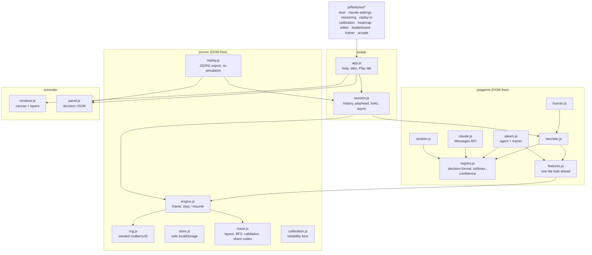
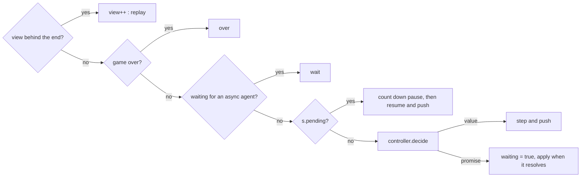

# Architecture

Chomp Agent is a static page built from classic `<script>` files that share one
global namespace, `Chomp`. There is no bundler. The code is split into layers
so that everything that decides what happens in a game runs in Node without a
DOM and is covered by tests. Everything that draws or listens to input sits on
top of those layers.



## Design principles

1. **The game is a value.** `game.s` is a plain object: numbers, strings, arrays and one `Uint8Array`. `structuredClone` copies it, so every history entry is a full snapshot, and forking is `Game.restore(maze, snapshot)`.
2. **Determinism.** The only randomness in the engine is `C.rng.nextFloat(s)`, whose state lives in `s.rng`. Agents that sample keep their own seeded generator. Same seed plus same choices gives the same game, bit for bit. Replays, verified import and fair duels all rely on this.
3. **One decision format.** Every controller, whether heuristic, learned, remote or human, returns `{ choice, probs, scores, best, confidence, by, agent, label }`. The panel, overlay, replay files, calibration and leaderboard only ever read that shape.
4. **Features are plugins.** Each file in `js/features/` pushes an init function onto `Chomp.features`. It receives the app and extends it through a small set of hooks, never by patching other features.
5. **Theme through tokens.** Colors are CSS custom properties. The renderer reads the `--b-*` board tokens from the canvas's computed style, so light, dark and CRT modes are pure CSS.

## The engine (`js/core/engine.js`)

`new Game(maze, { seed, lives })` sets up the state. The API is small:

| Call | Effect |
| --- | --- |
| `legal()` | Directions the chomper can move from its tile |
| `step(choice)` | Advances one tile and returns the events: `pellet`, `power`, `ghost`, `death`, `level`, `over` |
| `resume()` | After a lost life or cleared level (`s.pending`), resets positions and returns a `ready` event |
| `snapshot()` / `Game.restore()` | Clone out and clone in |

One `step` runs in this order: move the chomper, eat, check collisions, move
the ghosts, check collisions again (including the case where a ghost and the
chomper swap tiles), then count down the fright timer. Ghost behavior follows
the arcade game. Each ghost has a scatter corner and its own chase target (red
aims at the chomper, pink 4 tiles ahead, cyan a point mirrored off red, orange
chases until close, then retreats). The phase alternates, 35 ticks of scatter
in every 160. Frightened ghosts wander at random, at half speed. Eaten ghosts
follow a precomputed BFS field back to the house.

The engine has no idea of time. Pauses after a lost life are the session's job.

## Sessions (`js/app/session.js`)

A `Session` wraps a game with a history and a playhead:

```text
history[0]  ready       (state after setup)
history[1]  move 1      { state, decision, events, event }
...
history[n]  latest move
view        which entry is on screen
```

`tick()` is called once per timer tick by the app loop:



Async controllers (the Claude agent) return a Promise. The session remembers a
`token` when it asks. If the player forks or restarts before the answer
arrives, the token no longer matches and the late answer is dropped. If the
Promise rejects, the heuristic plays that move with `by: "fallback"` and
`error` set, so the game never stalls.

`fork(i)` restores `history[i].state` and truncates the history, which is what
**Resume from this move** does. Taking control with a key while scrubbing does
the same.

## The app shell (`js/app/app.js`)

The shell owns the main session, the Play tab's controls, the tabs and a single
`requestAnimationFrame` loop:

1. Accumulate elapsed time and call `tick()` on every running session in `app.sessions` once per `150 ms / speed`. The main session and both duel sessions all live in this Set.
2. For each registered view (`addView(renderer, getSession, isVisible)`), draw the entry on screen, interpolating actors from the previous entry by `(now - session.viewAt) / tickMs`.
3. Refresh the Play panel when something visible changed.

### Hooks for features

| Hook | Used for |
| --- | --- |
| `app.on('entry', (entry, session) => …)` | Every new history entry in any app-managed session (heatmaps, sounds, duel caps) |
| `app.on('over', session)` | A game ended (calibration, leaderboard, heatmap game count) |
| `app.on('panel', (entry, session))` | The Play panel was redrawn; add your own lines (score bars, Claude reason, rank) |
| `app.on('newgame' \| 'tab' \| 'theme' \| 'frame' \| 'agents' \| 'duel')` | Lifecycle |
| `app.ensureTab(id, label)` | Create a tab section. Tabs are built from `section.tab[data-label]` after features run |
| `app.addView(renderer, getSession, isVisible)` | Have the loop draw another board |
| `app.mainRenderer.layers.push({ id, z, draw })` | Draw on the Play board, `z: 'under'` (below actors) or `'over'` |
| `app.controls` | The Play tab's control row, for extra toggles |
| `app.newSession()`, `app.adoptSession()`, `app.setMaze()`, `app.setAgent()`, `app.setMode()` | Drive the game |

## Rendering (`js/render/`)

`Renderer.draw(a, b, t, now)` paints entry `b`, sliding actors from `a` by `t`.
When a move wraps through the tunnel it jumps instead of sliding across the
board. Pellets vanish at `t = 0.5`, when the chomper is on them. The order is
maze, then `under` layers (heatmap, danger tint, food path), then ghosts and
the chomper, then `over` layers (probability arrows), then the banner. The
canvas is sized to its container with a `ResizeObserver` and drawn at the
device pixel ratio. `onResize` lets static pictures (the editor, Stats
heatmaps) repaint, because resizing clears a canvas.

`panel.js` turns a decision into the `answers.move` document, the same object
written to replay files, and pretty-prints it with syntax-colored spans.

## Agents

### Shared helpers (`registry.js`, `features.js`)

- `decisionFromScores(scores, { temperature, rand })`: softmax over the scores, argmax for `best`, a sample for `choice` when `rand` is given, and confidence as 1 minus normalized entropy.
- `analyzeMove(game, dir)`: step one tile in `dir` and BFS from there. Returns whether the tile has a pellet, the distance to the nearest pellet, the BFS distance to each dangerous ghost, and edible ghosts reachable before the fright timer ends (`s.fright > d + 3`).

### Q-learning (`qlearn.js`)

Features for a move: bias, eats a pellet, eats a power pellet, distance to the
nearest pellet divided by (W + H), ghosts within 1 tile, a sum of (5 − d)/5
over ghosts within 5, a sum of 1/(1 + d) over edible ghosts, and turning back.

The reward is 0.1 × points gained, −0.1 per step, −50 for a lost life and +50
for a cleared level. A lost life is treated as terminal for the TD target. The
update is `w += α (r + γ max Q(s′,·) − Q(s,a)) f(s,a)`, with ε decaying
linearly from its starting value to 0.02 over the run. `Trainer.runFor(ms)`
works in slices so the Train tab can call it from `setTimeout` without freezing
the page. `scripts/pretrain.js` runs the same trainer in Node.

### Claude (`claude.js`)

Each move is one Messages API call through the official TypeScript SDK
(`@anthropic-ai/sdk`, ESM build from jsDelivr, loaded on first use):

```js
{
  model: 'claude-opus-5',            // or claude-sonnet-5, claude-haiku-4-5
  max_tokens: 4000,
  system: SYSTEM,                    // the rules, stable across turns
  messages: [{ role: 'user', content: boardText(game) }],
  output_config: {
    effort: 'low',                   // omitted for Haiku 4.5
    format: { type: 'json_schema', schema: schemaFor(legalMoves) },
  },
}
```

The schema limits `move` to the legal moves, requires one probability per
legal move, and requires a `reason` string. Opus requests go through
`client.beta.messages.create` with `fallbacks: "default"` and the
`server-side-fallback-2026-07-01` beta header. The agent checks
`stop_reason` for `refusal` and `max_tokens` before parsing, maps SDK error
classes to plain messages, and normalizes the probabilities, since a model's
numbers rarely sum to exactly 1.

## Persistence

`C.store` wraps localStorage with a `chomp:` prefix and JSON encoding. Every
call is wrapped in try/catch because storage can be missing or blocked, and a
failure returns the fallback value. The keys are listed in the README. The
heatmap batches writes (every 300 moves, at game over and on `pagehide`)
because it updates on every move.

## Replays and determinism

A replay stores the seed, the maze and each decision. On import,
`C.replay.rebuild` creates a fresh session from the seed, then for each move
line calls `resume()` if the game is paused and `apply()` with the recorded
choice. It then compares the resulting score and position with the file.
Because nothing else feeds randomness into the engine, a clean file always
matches. The `tampered replays are detected` test edits one line and checks
that the mismatch is reported.

## Extending

**Add an agent.** Create `js/agents/my-agent.js`, then add its script tag
before `js/app/session.js` and add it to `tests/load.js`:

```js
(function (root) {
  const C = root.Chomp;
  class MyAgent {
    constructor({ seed = 1, temperature = 1 } = {}) {
      this.key = 'mine'; this.label = 'My agent';
      this.temperature = temperature;
      this.rand = C.rng.makeRng(seed);
    }
    decide(game) {                       // may also return a Promise
      const scores = {};
      for (const d of game.legal()) scores[d] = /* your scoring */ 0;
      return C.decide.decisionFromScores(scores, {
        temperature: this.temperature, rand: this.rand, agent: this.key, label: this.label,
      });
    }
  }
  C.agents.register('mine', { label: 'My agent', usesTemperature: true, create: (o) => new MyAgent(o) });
})(globalThis);
```

It then appears in the Play and Duel menus, and calibration, heatmaps, replays
and the leaderboard pick it up automatically.

**Add a feature.** Create `js/features/my-feature.js` and push
`(app) => { … }` onto `Chomp.features`. Use `ensureTab` for a new tab, and
`on('entry')`, `on('over')` and `layers` to observe and draw.

**Share the leaderboard.** The static site keeps scores on the device.
To share them, replace `C.store.get/set('leaderboard')` in
`features/leaderboard.js` with calls to an endpoint that stores rows. Because
the engine is deterministic, the server can verify a claimed score by
replaying the uploaded JSONL with `C.replay.rebuild` in Node before accepting
it.

## Testing

`npm test` runs `node --test` over `tests/*.test.js`. `tests/load.js` loads the
DOM-free modules into `globalThis.Chomp` in page order. The suites cover:

- Maze validation and share-code round trips
- Engine determinism, game completion and custom mazes
- Probabilities and the confidence formula
- Session forking
- JSONL export, exact re-simulation and tamper detection
- Calibration sampling and binning
- Q-learning features, learning direction from zero weights, and the pretrained agent
- The Claude prompt, output schema and answer normalization, without network calls

The browser-only parts (rendering, tabs, audio) are checked by running the
page. CI runs the tests on every push (`.github/workflows/test.yml`).

## Known limitations

- Scores, heatmaps and trained weights are per device (localStorage).
- The Claude agent calls the API from the browser with the viewer's own key. It is meant for local use, not for a public deployment with a shared key.
- Audio starts only after you click **Sound**, because browsers block audio until the page has been interacted with.
- Custom mazes need the ghost house in a single row directly under the door. The validator enforces this.
